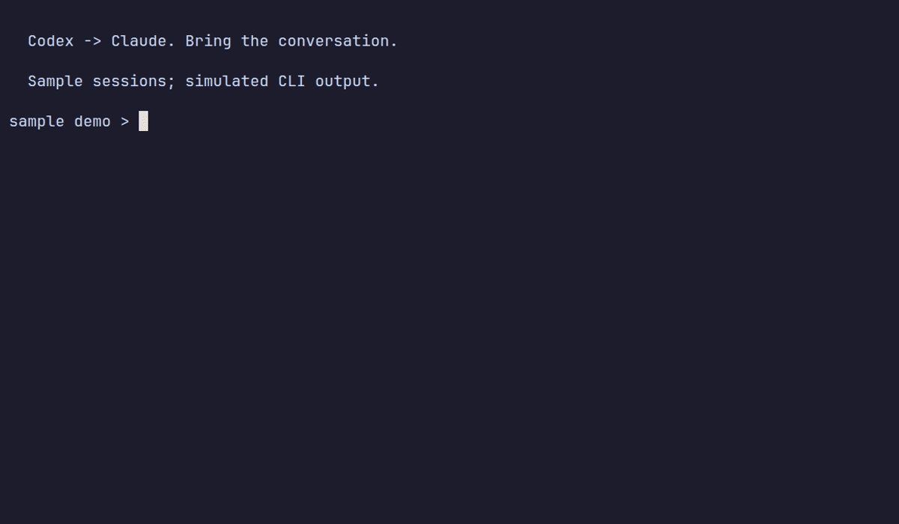

<!-- mcp-name: io.github.aytzey/showagent -->
<h1 align="center">showagent</h1>

<p align="center"><b>Switch coding agents. Bring the conversation.</b></p>

<p align="center">
Out of Claude quota halfway through a fix? Want Codex to review what Gemini planned?<br>
Started in Antigravity and want to finish in the terminal?<br>
<b>showagent</b> finds every coding-agent session on your machine and continues it in another agent,<br>
as that agent's own native session, in a few keystrokes.
</p>

<p align="center">
<a href="https://github.com/aytzey/showagent/actions/workflows/ci.yml"></a>
<a href="https://github.com/aytzey/showagent/releases/latest"></a>
<a href="https://github.com/aytzey/showagent/releases"></a>
<a href="https://github.com/aytzey/showagent/stargazers"></a>
<a href="LICENSE"></a>
</p>

<p align="center">
<b>Claude Code</b> · <b>Codex</b> · <b>Gemini CLI</b> · <b>Antigravity</b> <sup>new</sup> · <b>OpenCode</b> · <b>MiMoCode</b> · <b>Pi</b> · <b>jcode</b>
</p>



*Sample sessions; simulated CLI output. The handoff uses the real showagent
binary; the target CLI is a labeled demo stub. See
[compatibility evidence](docs/compatibility.md) for what has been tested.*

```sh
curl -fsSL https://raw.githubusercontent.com/aytzey/showagent/main/scripts/install.sh | sh
showagent
```

## Why showagent

Every coding agent keeps its history in its own private format. Switching
agents usually means starting over and re-explaining the task. showagent
reads every supported store, puts all of your sessions in one picker, and
moves a conversation between agents without leaving the terminal.

- **Move conversations between agents.** Eight agents, one picker. Hand a
  session from Claude Code to Codex, from Codex to Gemini CLI and back, or
  carry an Antigravity conversation into any of them.
- **Native sessions, not copy-paste.** The target agent gets a real session
  in its own store, so `claude --resume`, `codex resume`, `gemini --resume`,
  and the rest reopen it like any other session.
- **Preview before anything is written.** The first `x` shows the workspace,
  how many turns move, and what is dropped. Only the second `x` writes, and the
  original session is never modified.
- **Find any past session.** Group by workspace and fuzzy-search agent,
  session ID, paths, and first/latest prompts across every agent at once.
- **Your agent can use it too.** `showagent mcp` lets an MCP client search
  and read other agents' history, and request a hand-off.
- **Bring web chats in.** Import a public ChatGPT or Claude share link, a
  transcript file, or pasted text as a native coding-agent session.
- **Local only.** No hosted service, telemetry, or account. See the
  [privacy FAQ](#faq).

### Typical hand-offs

| You are in | You want | Press |
|---|---|---|
| Claude Code, out of quota mid-task | Keep going in Codex or Gemini CLI | `o` to pick the target, `x` `x` to convert, `enter` to open it |
| Codex, stuck on a bug | A second opinion from Claude or Gemini | the same `o`, `x` `x`, `enter` |
| Antigravity IDE | Continue the same conversation from a terminal agent | the same `o`, `x` `x`, `enter` |
| Any agent except Antigravity | A clean branch to try another direction | `n` |
| Any agent | Reopen a session from last week in the agent that wrote it | `/` to search, `enter` (Antigravity IDE conversations are hand-off only) |

## Quick start

You need an existing local session, the target agent's CLI on `PATH`, and its
normal sign-in completed. Keep the original workspace available.

```sh
showagent
```

1. Press `/` and search for the workspace or a phrase in the session's first
   or latest user prompt. Press `enter` to finish searching, then select the
   session you want to continue.
2. Press `o` until the target is `claude` (or another installed agent).
3. Press `x` to review the workspace, message scope, and state that will be
   dropped. Press `x` again to write and select the new session.
4. Press `enter` to open that new session in the target CLI.

Prefer commands? The [Codex → Claude handoff guide](docs/handoff-guide.md)
walks through selecting an explicit session ID, previewing, converting, and
resuming it. It also explains the reverse direction and what conversion preserves.

If showagent saved you a re-explanation, a ⭐ helps other people find it.

## Install

On **Linux or macOS**, install the latest GitHub release. The script checks
the archive against that release's `SHA256SUMS` and normally installs in
`~/.local/bin`:

```sh
curl -fsSL https://raw.githubusercontent.com/aytzey/showagent/main/scripts/install.sh | sh
```

If that directory is not on your `PATH`, run `~/.local/bin/showagent` directly
or add the directory to your shell's `PATH`.

On **Windows**, download and extract the `windows_amd64.zip` archive from the
[latest release](https://github.com/aytzey/showagent/releases/latest), then run
`.\showagent.exe` in PowerShell from the extracted directory. Windows support
is **experimental**; see [platform and native-resume evidence](docs/compatibility.md).

Homebrew and Go installation remain available under
[other installation options](#other-installation-options).
[Distribution details](docs/distribution.md) explain version differences between channels.

## Supported agents

| Agent | CLI | Sessions read from | Env override | Convert from | Convert to |
|---|---|---|---|:---:|:---:|
| Codex | `codex` | `~/.codex/sessions/**/*.jsonl` | `CODEX_HOME` | ✅ | ✅ |
| Claude Code | `claude` | `~/.claude/projects/**/*.jsonl` | `CLAUDE_HOME` | ✅ | ✅ |
| Gemini CLI | `gemini` | `~/.gemini/tmp/<project>/chats/` | `GEMINI_CLI_HOME` | ✅ | ✅ |
| Antigravity | `agy` | `~/.gemini/antigravity-cli/` (CLI), `~/.gemini/antigravity-ide/` (IDE) | `ANTIGRAVITY_HOME` | ✅ | — |
| OpenCode | `opencode` | `opencode.db`, via the `opencode` CLI | `OPENCODE_DATA_HOME` | ✅ | ✅ |
| MiMoCode | `mimo` | `mimocode.db`, via the `mimo` CLI | `MIMOCODE_HOME` | ✅ | ✅ |
| jcode | `jcode` | `~/.jcode/sessions/*.json` | `JCODE_HOME` | ✅ | ✅ |
| Pi | `pi` | `~/.pi/agent/sessions/**/*.jsonl` | `PI_CODING_AGENT_DIR`, `PI_CODING_AGENT_SESSION_DIR` | ✅ | ✅ |

Notes:

- The table describes implemented adapters, not a claim that every provider
  version and conversion direction has passed a real CLI test. See the
  [compatibility record](docs/compatibility.md).
- **Antigravity** has two surfaces. Conversations from the `agy` terminal
  agent are listed with their workspace and reopen with
  `agy --conversation <id>`. Conversations from the Antigravity IDE are listed
  as hand-off sources: convert them into any other supported agent.
  showagent reads the plain-text transcript Antigravity keeps next to each
  conversation and never opens Antigravity's private databases.
  Converting *into* Antigravity is not available yet: `agy` has no way to
  create a conversation without a model turn, and in that turn the model can
  write files if the handed-off text asks it to. showagent will add this
  direction when `agy` offers a safe import path.
- OpenCode and MiMoCode store sessions in a SQLite database, so every
  operation (discover, export, import, delete) goes through their own CLI;
  showagent never writes into the database directly. OpenCode, MiMoCode and
  jcode only appear when their CLI is installed.
- The picker only offers hand-off targets whose CLI is on `PATH`.
  Scripted conversion to file-backed agents can still
  prepare a session before their CLI is installed; OpenCode and MiMoCode
  always require their CLI because the import goes through the agent itself.
- jcode is a niche, experimental agent CLI. Its support is auto-hidden: if no
  `jcode` binary is on `PATH`, showagent never shows it.
- Pi sessions are versioned JSONL trees. showagent follows Pi's active leaf
  through `parentId` links, so abandoned branches are not previewed or moved
  into another agent. Converted sessions use Pi's native v3 format; the
  [compatibility record](docs/compatibility.md) distinguishes file conversion
  from native loader and model-continuation checks.
- A project-local Pi `sessionDir` is visible when showagent is launched from
  that project. Like Pi itself, showagent cannot discover arbitrary custom
  session roots belonging to other projects unless one is selected globally
  with `PI_CODING_AGENT_SESSION_DIR`.
- Platforms: Linux and macOS (amd64 + arm64). Windows (amd64) builds are
  released but **experimental**: resume runs the agent as a child process
  instead of replacing showagent.

## Other installation options

```sh
# Homebrew (Linux/macOS)
brew install aytzey/tap/showagent

# Go 1.26.9+
go install github.com/aytzey/showagent/cmd/showagent@latest
```

Homebrew, GitHub releases, Go module versions, and MCP bundles can update on
different schedules. Go's `@latest` follows module version resolution, which
can differ from GitHub's latest release; check `showagent --version` and
`showagent --help` after installing. See [distribution details](docs/distribution.md)
for channel-specific features and update instructions.

Archives are also available for `linux`/`darwin` amd64 + arm64 and `windows`
amd64 (experimental) on the [releases page](https://github.com/aytzey/showagent/releases/latest).

## More commands

```sh
showagent                  # open the interactive picker
showagent list             # plain table of every session
showagent list --json      # the same, machine-readable
showagent transcript latest --max-turns 50 --json
                           # bounded, secret-redacted context for local handoff
showagent resume latest    # reopen the most recent session, any agent
showagent convert SOURCE_SESSION_ID --to claude --dry-run
                           # preview exactly what a hand-off would carry/drop
showagent import --url CHAT_SHARE_URL --to codex --cwd ./my-project
                           # create a native coding-agent session from a public web chat
showagent import --file conversation.txt --into codex:EXACT_SESSION_ID
                           # add text to an existing Codex session's context
showagent info latest      # exact resume command + storage location
showagent mcp              # serve session history to MCP-capable agents (stdio)
showagent mcp --read-only  # same search/transcript tools, without tools that write copies
showagent mcp --allow-secrets
                           # explicitly allow verbatim secret-like transcript values
showagent update           # update a standalone install (Homebrew: brew upgrade aytzey/tap/showagent)
showagent --help           # full CLI help
```

Replace `SOURCE_SESSION_ID` with the ID you selected from `showagent list`.
The `transcript` command is not present in older builds such as v0.11.0;
check [distribution details](docs/distribution.md) if your help output differs.
See [web conversation import](docs/web-import.md) for accepted transcript
formats, security boundaries, and the difference between creating a session
and adding context to an existing one.

### Keybindings

| Key | Action |
|---|---|
| `↑/k`, `↓/j`, `pgup/pgdn` | Move through sessions |
| `/` | Search agent, session id, paths, and first/latest user prompts (every word must match) |
| `enter` | Resume the selected session in its own CLI |
| `1`..`9` | Toggle provider visibility, numbered as listed in the header bar |
| `p` | Cycle the preview column: first → latest → first + latest message |
| `space` | Collapse or expand the selected workspace group |
| `o` | Cycle the convert target for the selected session |
| `t` | Cycle the convert scope: all turns, or latest 200/100/50/20/10 |
| `x` | Preview convert; press `x` again to write and select the new session |
| `n` | Branch: copy the transferable conversation to a new session in the same agent (not available for Antigravity) |
| `y` | Toggle the provider's yolo resume mode (jcode/Pi add no flag) |
| `C` | Compound: resume with a learnings-capture prompt (see below) |
| `i` | Import a ChatGPT/Claude share link or pasted transcript |
| `d`, `del`, `backspace` | Delete the session — second press confirms, moving disarms |
| `r` | Rescan session stores (keeps cursor, search, and filters) |
| `?` | Hide or show the keys box (on small terminals: the full keybinding overlay) |
| `esc` | Clear search / close overlay / cancel an armed delete (never quits) |
| `q`, `ctrl+c` | Quit |

## Scripting

`showagent list --json` emits an array sorted newest-first — the field names
are a stable contract:

```json
[
  {
    "id": "1f7c9a2e-4b31-4c8e-9d02-8a5e3f6b1c44",
    "provider": "codex",
    "workspace": "/home/you/code/api-server",
    "updated": "2026-07-08T19:51:25Z",
    "first_message": "Add rate limiting to POST /v1/charges",
    "last_message": "the redis TTL test is flaky - mock the clock"
  }
]
```

`showagent resume <id|latest> [--yolo]` resumes without the picker, so a shell
alias can reopen your last session in one keystroke.

`showagent transcript <id|latest> [--max-turns N] [--json]` exports the most
recent turns for local tools that need a bounded context handoff. Output is
always secret-redacted, marked as untrusted history, and capped at 500 turns.

`showagent convert <id|latest> --to <provider> --dry-run` prints the hand-off
before writing anything: source session, target provider, workspace, scope,
transferable turn count, last user ask, and the agent-specific state that will
be dropped. Remove `--dry-run` to write the converted session, then showagent
prints the resume recipe for the new row.

`showagent import --url <public-share-url> --to <provider> --cwd <directory>`
creates a new native session from a ChatGPT or Claude web share. Use `--file`
or `--stdin` for copied transcripts, and preview with `--dry-run`. Existing
Codex sessions accept `--into codex:<exact-id>`; imported messages become model
context but may not appear as normal chat bubbles. Other existing-session
targets stay disabled until their CLIs provide a safe same-ID append contract.

`showagent info <id|latest> [--yolo]` prints the exact resume command,
working directory, and storage location for a session.

Exit codes: `0` success, `1` error (including "no sessions found"), `2` usage.
When stdout is not a terminal, plain `showagent` prints the `list` table, so
pipes just work.

## Use it from inside your agent (MCP)

`showagent mcp` runs a stdio MCP server, so an MCP client can find sessions
from the supported local agents, read their recent transcript turns, and
request a new native session in another agent. For example, ask it to find a
Codex session whose first or latest prompt mentions rate limiting, then read
that session for context. Search matches workspace and first/last user-message
text; it does not search every message in the transcript.

The server returns a resume command for you to run. It does not launch an
interactive agent or continue a model conversation by itself.

```sh
# Claude Code
claude mcp add showagent -- showagent mcp
```

```toml
# Codex (~/.codex/config.toml)
[mcp_servers.showagent]
command = "showagent"
args = ["mcp"]
```

An MCP client can send returned transcript text to its model provider. Common
secret-like values are therefore redacted by default, and every transcript is
marked as untrusted historical data rather than instructions. If verbatim
values are required, the user must explicitly start the server as
`showagent mcp --allow-secrets`; an MCP tool call cannot bypass redaction.
For clients that should never write session copies, register
`showagent mcp --read-only`; that mode omits `branch_session` and
`convert_session` entirely.

Tools:

| Tool | What it does |
|---|---|
| `list_sessions` | Find supported local sessions — filter by provider, workspace substring, or free text over workspace + first/last user message (default 25, max 100 results) |
| `get_transcript` | Read recent user/assistant turns (default 50, hard max 500); secrets are redacted unless the server was explicitly started with `--allow-secrets` |
| `branch_session` | Copy the transferable conversation to a new session in the same agent; returns the new id, file, and resume command |
| `convert_session` | Rewrite a session into another agent's native format; returns the new id, file, and resume command |
| `resume_command` | The exact shell command (and cwd) that resumes a session — returned as a string, **never executed** |

The default MCP surface is deliberately non-destructive: there is **no delete
tool**, and it never launches or resumes an interactive agent. OpenCode storage
operations still go through the local `opencode` CLI because its sessions live
in SQLite. Deleting sessions stays exclusive to the TUI, where it takes two key
presses with a human watching. Branch and convert only add new sessions —
originals are never modified — and `--read-only` removes even those additive
tools.

## How it compares

[claude-squad](https://github.com/smtg-ai/claude-squad) manages parallel live
agents with tmux and git worktrees. [ccmanager](https://github.com/kbwo/ccmanager)
also manages live agent sessions and worktrees, without requiring tmux.
[Agent Sessions](https://github.com/jazzyalex/agent-sessions) offers a macOS GUI
for browsing agent history. [hstry](https://github.com/byteowlz/hstry) provides
a shared history database, search, and native-format conversion.

showagent focuses on finding and continuing the sessions already on your
machine: a terminal picker that reads existing stores, previews a handoff,
and writes a new session for another supported agent. It can sit alongside
the tools you use to run live tasks. Start with the
[handoff guide](docs/handoff-guide.md) and check the
[tested compatibility scope](docs/compatibility.md) for your workflow.

## Compound engineering

Press `C` on a session and pick an agent. showagent resumes the session there
and starts it on a compound-engineering pass: review what was solved, then
record the durable learnings as markdown.

Learnings are pooled per project but shared across agents: each workspace gets
a directory under `~/.showagent/learnings/<project>/` (override with
`SHOWAGENT_LEARNINGS_DIR`) that every agent reads and writes. Picking an agent
that did not create the session converts its transferable user and assistant
messages first; provider-private tool and runtime state is not copied.

`showagent setup` installs the companion
[compound-engineering plugin](https://github.com/EveryInc/compound-engineering-plugin)
into the Codex, Claude Code, and Pi CLIs found on the machine. For Pi it also
installs the `pi-subagents` and `pi-ask-user` companion packages. The command
is idempotent and only installs what is missing.

## FAQ

**Is my session data sent anywhere?**
showagent itself does not upload session content and has no telemetry or
account. An MCP client may send `get_transcript` results to that client's model
provider, so MCP transcripts redact common secrets by default; keep that
boundary in mind before registering the server. Web import fetches only the
public ChatGPT or Claude share URL you explicitly provide; it does not use
browser cookies, private-chat URLs, or arbitrary hosts. The optional release
updater and startup update check also use HTTP (disable the update check with
`SHOWAGENT_NO_UPDATE_CHECK=1`). `showagent setup` invokes the installed
Codex/Claude/Pi CLIs, which may download the requested plugin. Message previews
also redact password-like strings and API keys before rendering (covered by
tests in [`internal/session/session_test.go`](internal/session/session_test.go)).
Release archives ship with a `SHA256SUMS` file, and releases after v0.7.0
also carry GitHub build provenance — verify with
`gh attestation verify <file> --repo aytzey/showagent`.

**How does conversion work?**
Conversion extracts the user and assistant turns from the source transcript
and writes a brand-new session in the target agent's native format (for
OpenCode and MiMoCode via their `import` command), so the target's own resume
command picks it up. Code blocks, newlines, and indentation are preserved, and
the original session is never modified. For file-backed targets, showagent
writes the new file itself: private (`0600`) and atomically, so a crash cannot
leave a half-written session in another tool's store.

Trust is explicit: in the TUI, the first `x` shows the hand-off preview and the
second `x` writes it. In scripts, use `showagent convert ... --dry-run` for
the same preview. Conversion intentionally does **not** copy tool-call
internals, approval history, encrypted reasoning blobs, or provider
attachments: those are private to the source agent and would not replay
correctly anyway. Branching uses the same safe user/assistant-turn projection;
it does not byte-clone provider-private runtime metadata. `t` / `--scope` trims
the scope to the latest N turns before converting.

**What does delete actually do?**
Codex sessions are deleted through `codex delete --force`; OpenCode through
`opencode session delete` (which cascades inside its database). Claude Code
removes the JSONL plus its matching index entry, jcode removes the JSON plus
backup/journal sidecars, and Gemini and Pi remove their session files.
Antigravity conversations are not deleted by showagent; delete them from
`agy`'s own `/resume` picker so its databases stay consistent. Delete
always takes two presses, and moving the cursor disarms it.

**Windows?**
Binaries are released, but resume uses a child process instead of replacing
showagent. Windows remains experimental; the
[compatibility record](docs/compatibility.md) lists the checks actually run.

**A session is missing from the list.**
Run `showagent list` with no sessions found and it prints exactly which
directories were scanned and which env vars override them. `r` rescans
in-place after you start a new conversation.

## Adding a provider

A provider implements the interface in
[`internal/session/provider.go`](internal/session/provider.go), including
discovery, resume arguments, transcript extraction, and conversion.
[`gemini.go`](internal/session/gemini.go) (file-based store),
[`opencode.go`](internal/session/opencode.go) (CLI-based store), and
[`antigravity.go`](internal/session/antigravity.go) (a hand-off source only)
are the templates. Register it in the `registry` slice and the TUI picks up badges,
filter keys, and convert targets automatically. Add a matching env override
so its tests stay hermetic. Issues and PRs welcome.

## Building

```sh
git clone https://github.com/aytzey/showagent.git
cd showagent
go test ./...
go build -o showagent ./cmd/showagent
```

The minimum supported toolchain is Go 1.26.9 (see `go.mod`); CI also runs race tests,
golangci-lint, `govulncheck`, and every published cross-compile target.

The illustrated demo uses [vhs](https://github.com/charmbracelet/vhs),
fabricated fixtures, and simulated agent output; it is not a native-resume
test. Recording and isolation instructions are in [`demo/README.md`](demo/README.md).

Security issues and sensitive-data exposure should be reported privately; see
[`SECURITY.md`](SECURITY.md). Contributions are covered by
[`CONTRIBUTING.md`](CONTRIBUTING.md).

## Star history

<a href="https://star-history.com/#aytzey/showagent&Date">
  <picture>
    <source media="(prefers-color-scheme: dark)" srcset="https://api.star-history.com/svg?repos=aytzey/showagent&type=Date&theme=dark">
    
  </picture>
</a>

## License

MIT. Built with [Bubble Tea](https://github.com/charmbracelet/bubbletea),
[Bubbles](https://github.com/charmbracelet/bubbles), and
[Lip Gloss](https://github.com/charmbracelet/lipgloss).
