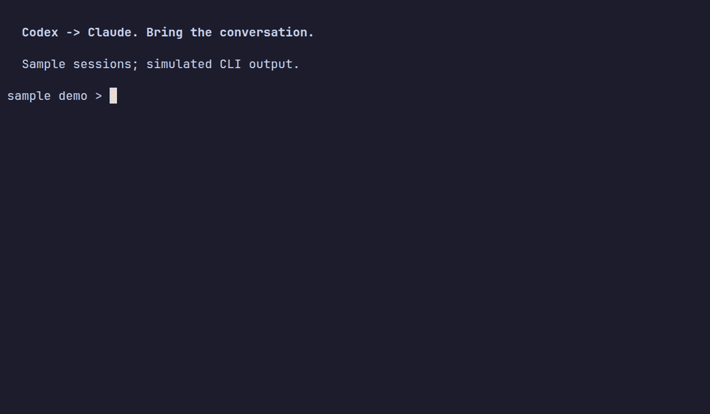
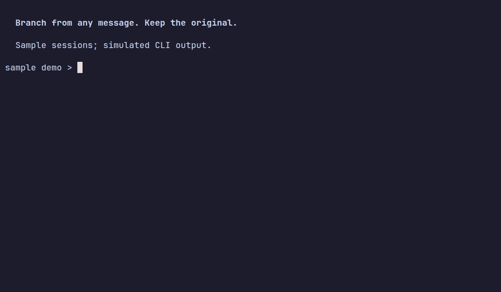

<!-- mcp-name: io.github.aytzey/showagent -->
<h1 align="center">showagent</h1>

<p align="center"><b>Switch coding agents. Bring the conversation. Branch it from any message.</b></p>

<p align="center">
Out of Claude quota halfway through a fix? Want Codex to review what Gemini planned?<br>
<b>showagent</b> finds every coding-agent session on your machine and continues it in another agent<br>
as a native session, or branches it from the exact message you choose. No copy-paste, no re-explaining.
</p>

<p align="center">
<a href="https://github.com/aytzey/showagent/actions/workflows/ci.yml"></a>
<a href="https://github.com/aytzey/showagent/releases/latest"></a>
<a href="https://github.com/aytzey/showagent/releases"></a>
<a href="https://github.com/aytzey/showagent/stargazers"></a>
<a href="LICENSE"></a>
</p>

<p align="center">
<b>Claude Code</b> · <b>Codex</b> · <b>Gemini CLI</b> · <b>Antigravity</b> · <b>OpenCode</b> · <b>MiMoCode</b> · <b>Pi</b> · <b>jcode</b>
</p>



```sh
curl -fsSL https://raw.githubusercontent.com/aytzey/showagent/main/scripts/install.sh | sh
# or: brew install aytzey/tap/showagent
showagent
```

<sub>The demo runs the real showagent binary on sample sessions; the target CLI
is a labeled stub. See [compatibility evidence](docs/compatibility.md) for what
has been tested with real agents.</sub>

<p align="center">
<a href="#quick-start">Quick start</a> ·
<a href="#branch-from-any-message">Branch from any message</a> ·
<a href="#install">Install</a> ·
<a href="#supported-agents">Supported agents</a> ·
<a href="#commands">Commands</a> ·
<a href="#keybindings">Keys</a> ·
<a href="#use-it-from-inside-your-agent-mcp">MCP</a> ·
<a href="#how-it-compares">Compare</a> ·
<a href="#faq">FAQ</a>
</p>

## Why showagent

Every coding agent keeps its history in its own private format. Switching
agents usually means starting over and re-explaining the task. showagent
reads every supported store, puts all of your sessions in one picker, and
moves a conversation between agents without leaving the terminal.

- **One picker for every agent.** Sessions from eight agents, grouped by
  workspace. Search by agent, session ID, path, and first or latest prompt.
- **Native sessions, not pasted summaries.** The target agent gets a real
  session in its own store, so `claude --resume`, `codex resume`,
  `gemini --resume`, and the rest reopen it like any other session.
- **Branch from any message.** Wrong turn? Copy the session up to just before
  it and ask differently; the original stays untouched. The same chooser sets
  where a hand-off picks up.
- **Preview before anything is written.** See the workspace, how many turns
  move, and what is left behind. The original session is never modified.
- **One command when you are in a hurry.**
  `showagent convert latest --to codex --open` writes the Codex session and
  continues there.
- **Your agent can use it too.** `showagent mcp` lets an MCP client search
  and read other agents' history, dry-run a hand-off, and request one.
- **Bring web chats in.** Import a public ChatGPT or Claude share link, a
  transcript file, or pasted text as a native coding-agent session.
- **Local only.** One static binary. No hosted service, telemetry, or
  account. See the [privacy FAQ](#faq).

Seven of the eight agents can also receive a session, so 49 hand-off
directions are implemented. The [compatibility record](docs/compatibility.md)
lists which of them have been checked against real CLIs.

### Typical hand-offs

| You are in | You want | Press |
|---|---|---|
| Claude Code, out of quota mid-task | Keep going in Codex or Gemini CLI | `o` to pick the target, `x` `enter` `x` to convert, `enter` to open it |
| Codex, stuck on a bug | A second opinion from Claude or Gemini | the same `o`, `x` `enter` `x`, `enter` |
| Antigravity IDE | Continue the same conversation from a terminal agent | the same `o`, `x` `enter` `x`, `enter` |
| Any agent except Antigravity | Try another direction from any user message | `n`, choose the message, `tab` to leave it out, `enter` to branch |
| Any agent | Reopen a session from last week in the agent that wrote it | `/` to search, `enter` (Antigravity IDE conversations are hand-off only) |
| Any agent | The resume command for another pane, a script, or a teammate | `c` copies it |

## Quick start

You need an existing local session, the target agent's CLI on `PATH`, and its
normal sign-in completed. Keep the original workspace available.

**In the picker**

```sh
showagent
```

1. Press `/` and search for the workspace or a phrase in the session's first
   or latest user prompt. Press `enter` to finish searching, then select the
   session you want to continue.
2. Press `o` until the target is `claude` (or another installed agent).
3. Press `x` and choose where to continue: the conversation's end, or any
   earlier user message (`/` searches them). Press `enter` to review the
   hand-off, then `x` to write and select the new session.
4. Press `enter` to open that new session in the target CLI.

**In one command**

```sh
showagent convert latest --to codex --dry-run   # see what would move
showagent convert latest --to codex --open      # write it and continue in Codex
```

`latest` is the most recently updated session on this machine, in any agent
and any workspace. Pass an ID from `showagent list` to choose another one.

The [Codex → Claude handoff guide](docs/handoff-guide.md) walks through
selecting an explicit session ID, previewing, converting, and resuming it. It
also explains the reverse direction and what conversion preserves.

If showagent saved you a re-explanation, a ⭐ helps other people find it.

### What moves

| Carried into the new session | Stays with the source agent |
|---|---|
| User and assistant message text in the scope you chose | Tool calls and tool results |
| Code blocks, newlines, and indentation | Permission and approval history |
| The workspace and a new native session ID | Runtime metadata, attachments, and encrypted reasoning |

Project files are not copied, rewound, or changed; both agents work in the
same directory. The [handoff guide](docs/handoff-guide.md#what-moves-with-the-conversation)
has the full list.

## Branch from any message



<sub>The demo runs the real showagent binary on sample sessions with simulated
CLI output. It searches for "sliding", leaves user #4 out, and opens a new Codex
session ending on the preceding reply. No model is called.</sub>

A branch is a new session in the same agent, copied up to the point you choose.
If a conversation takes a wrong turn, branch just before that message and ask
it differently. The original stays untouched, so both lines of work remain.

Press `n` on a session to open **Branch · choose where the copy picks up**.
Press `x` for the same chooser when handing off to another agent.

| Key | In the chooser |
|---|---|
| `↑/↓` | Choose `Continue from the end` or any user message, newest first |
| `/` | Search the messages by words or `#N` |
| `tab` | Leave the chosen message out: the copy ends on the reply before it, so you can ask it differently |
| `enter` | Create the branch, or open the hand-off preview (while searching: keep the search) |
| `esc` | Clear the search, or cancel |

A live `keeps X of Y turns` line shows how much the copy keeps, and
`ctrl+d/u` scrolls a long message.

The same choice from the command line:

```sh
showagent messages latest                           # numbered user messages, newest first
showagent branch latest --before-user 4 --dry-run   # preview what the copy keeps
showagent branch latest --before-user 4 --open      # write the branch and open it
showagent convert latest --to claude --before-user 4 --open
                                                    # the same cut, handed to Claude Code
```

`--through-user N` ends the copy on message N instead of before it. A new
branch becomes `latest`, so use the session ID from `showagent list` when you
run more than one step.

A branch carries user and assistant message text only: no tool calls, tool
results, permissions, or attachments. Project files are never rewound; the
workspace stays in its current state. Antigravity sessions cannot be branched.

## Install

On **Linux or macOS**, install the latest GitHub release. The script checks
the archive against that release's `SHA256SUMS` and normally installs in
`~/.local/bin`:

```sh
curl -fsSL https://raw.githubusercontent.com/aytzey/showagent/main/scripts/install.sh | sh
```

If that directory is not on your `PATH`, run `~/.local/bin/showagent` directly
or add the directory to your shell's `PATH`.

On **Windows**, download and extract the `windows_amd64.zip` archive from the
[latest release](https://github.com/aytzey/showagent/releases/latest), then run
`.\showagent.exe` in PowerShell from the extracted directory. Windows support
is **experimental**; see [platform and native-resume evidence](docs/compatibility.md).

### Other installation options

```sh
# Homebrew (Linux/macOS)
brew install aytzey/tap/showagent

# Go 1.26.11+
go install github.com/aytzey/showagent/cmd/showagent@latest
```

Archives are also available for `linux`/`darwin` amd64 + arm64 and `windows`
amd64 (experimental) on the [releases page](https://github.com/aytzey/showagent/releases/latest).
Update a standalone install with `showagent update`, and a Homebrew install
with `brew upgrade aytzey/tap/showagent`.

Homebrew, GitHub releases, Go module versions, and MCP bundles can update on
different schedules. Go's `@latest` follows module version resolution, which
can differ from GitHub's latest release; check `showagent --version` and
`showagent --help` after installing. See [distribution details](docs/distribution.md)
for channel-specific features and update instructions.

## Supported agents

| Agent | CLI | Sessions read from | Env override | Convert from | Convert to |
|---|---|---|---|:---:|:---:|
| Codex | `codex` | `~/.codex/sessions/**/*.jsonl` | `CODEX_HOME` | ✅ | ✅ |
| Claude Code | `claude` | `~/.claude/projects/**/*.jsonl` | `CLAUDE_HOME` | ✅ | ✅ |
| Gemini CLI | `gemini` | `~/.gemini/tmp/<project>/chats/` | `GEMINI_CLI_HOME` | ✅ | ✅ |
| Antigravity | `agy` | `~/.gemini/antigravity-cli/` (CLI), `~/.gemini/antigravity-ide/` (IDE) | `ANTIGRAVITY_HOME` | ✅ | — |
| OpenCode | `opencode` | `opencode.db`, via the `opencode` CLI | `OPENCODE_DATA_HOME` | ✅ | ✅ |
| MiMoCode | `mimo` | `mimocode.db`, via the `mimo` CLI | `MIMOCODE_HOME` | ✅ | ✅ |
| jcode | `jcode` | `~/.jcode/sessions/*.json` | `JCODE_HOME` | ✅ | ✅ |
| Pi | `pi` | `~/.pi/agent/sessions/**/*.jsonl` | `PI_CODING_AGENT_DIR`, `PI_CODING_AGENT_SESSION_DIR` | ✅ | ✅ |

The table describes implemented adapters, not a claim that every provider
version and conversion direction has passed a real CLI test. See the
[compatibility record](docs/compatibility.md).

Platforms: Linux and macOS (amd64 + arm64). Windows (amd64) builds are
released but **experimental**: resume runs the agent as a child process
instead of replacing showagent.

<details>
<summary><b>Notes on each agent</b></summary>

- **Antigravity** has two surfaces. Conversations from the `agy` terminal
  agent are listed with their workspace and reopen with
  `agy --conversation <id>`. Conversations from the Antigravity IDE are listed
  as hand-off sources: convert them into any other supported agent.
  showagent reads the plain-text transcript Antigravity keeps next to each
  conversation and never opens Antigravity's private databases.
  Converting *into* Antigravity is not available yet: `agy` has no way to
  create a conversation without a model turn, and in that turn the model can
  write files if the handed-off text asks it to. showagent will add this
  direction when `agy` offers a safe import path.
- **OpenCode and MiMoCode** store sessions in a SQLite database, so every
  operation (discover, export, import, delete) goes through their own CLI;
  showagent never writes into the database directly. OpenCode, MiMoCode and
  jcode only appear when their CLI is installed. [Discovery and caching](docs/discovery.md)
  covers the OpenCode version adapters.
- **Hand-off targets.** The picker only offers targets whose CLI is on
  `PATH`. Scripted conversion to file-backed agents can still prepare a
  session before their CLI is installed; OpenCode and MiMoCode always require
  their CLI because the import goes through the agent itself.
- **jcode** is a niche, experimental agent CLI. Its support is auto-hidden: if
  no `jcode` binary is on `PATH`, showagent never shows it.
- **Pi** sessions are versioned JSONL trees. showagent follows Pi's active
  leaf through `parentId` links, so abandoned branches are not previewed or
  moved into another agent. Converted sessions use Pi's native v3 format; the
  [compatibility record](docs/compatibility.md) distinguishes file conversion
  from native loader and model-continuation checks.
- A project-local Pi `sessionDir` is visible when showagent is launched from
  that project. Like Pi itself, showagent cannot discover arbitrary custom
  session roots belonging to other projects unless one is selected globally
  with `PI_CODING_AGENT_SESSION_DIR`.

</details>

## Commands

```sh
showagent                  # open the interactive picker
showagent list             # plain table of every session
showagent list --json      # the same, machine-readable
showagent resume latest    # reopen the most recent session, any agent
showagent info latest      # exact resume command + storage location
showagent messages latest --all
                           # every user message, newest first, with absolute numbers
showagent branch latest --before-user 4 --dry-run
                           # preview a same-agent copy ending before user message #4
showagent branch latest --before-user 4 --open
                           # write the branch and open it in its agent
showagent convert SOURCE_SESSION_ID --to claude --dry-run
                           # preview exactly what a hand-off would carry/drop
showagent convert SOURCE_SESSION_ID --to claude --open
                           # write the Claude session and continue there
showagent transcript latest --markdown > session.md
                           # secret-redacted transcript to read, review, or paste
showagent transcript latest --max-turns 50 --json
                           # bounded, secret-redacted context for local handoff
showagent import --url CHAT_SHARE_URL --to codex --cwd ./my-project
                           # create a native coding-agent session from a public web chat
showagent import --file conversation.txt --into codex:EXACT_SESSION_ID
                           # add text to an existing Codex session's context
showagent mcp              # serve session history to MCP-capable agents (stdio)
showagent mcp --read-only  # search, transcripts, and hand-off preview; no tools that write copies
showagent mcp --allow-secrets
                           # explicitly allow verbatim secret-like transcript values
showagent update           # update a standalone install (Homebrew: brew upgrade aytzey/tap/showagent)
showagent --help           # full CLI help
```

Replace `SOURCE_SESSION_ID` with the ID you selected from `showagent list`.
`convert --open`, `transcript --markdown`, and the `c` key arrived in v0.16.0.
So did `branch`, `--before-user` on `branch` and `convert`, `messages --all`,
and the chooser's full message list, `/` search, and `tab` leave-out.
Check [distribution details](docs/distribution.md) if your help output differs.
See [web conversation import](docs/web-import.md) for accepted transcript
formats, security boundaries, and the difference between creating a session
and adding context to an existing one.

### Keybindings

| Key | Action |
|---|---|
| `↑/k`, `↓/j`, `pgup/pgdn` | Move through sessions |
| `/` | Search agent, session id, paths, and first/latest user prompts (every word must match) |
| `enter` | Resume the selected session in its own CLI |
| `c` | Copy the command that resumes the selected session, with the `cd` into its workspace, to the clipboard |
| `1`..`8` | Toggle fixed provider slots: Codex, Claude, jcode, OpenCode, MiMoCode, Gemini, Pi, Antigravity |
| `p` | Cycle the preview column: first → latest → first + latest message |
| `space` | Collapse or expand the selected workspace group |
| `o` | Cycle the convert target for the selected session |
| `t` | Cycle the convert scope: all turns, or latest 200/100/50/20/10 |
| `x` | Choose any user message or the end, `enter` to preview the hand-off, then `x` to write and select the new session |
| `n` | Choose any user message or the end, then `enter` to branch in the same agent (not available for Antigravity) |
| `y` | Toggle the provider's yolo resume mode (jcode/Pi add no flag) |
| `C` | Compound: resume with a learnings-capture prompt (see below) |
| `i` | Import a ChatGPT/Claude share link or pasted transcript |
| `d`, `del`, `backspace` | Delete the session — second press confirms, moving disarms |
| `r` | Rescan session stores (keeps cursor, search, and filters) |
| `?` | Hide or show the keys box (on small terminals: the full keybinding overlay) |
| `esc` | Clear search / close overlay / cancel an armed delete (never quits) |
| `q`, `ctrl+c` | Quit |

After `n` or `x`, use `↑/↓` or `pgup/pgdn` to choose, `/` to search by words
or `#N`, and `tab` to leave a message out (except the first when nothing
precedes it). `ctrl+d/u` scrolls a long message. `enter` finishes searching;
the next `enter` creates the branch or opens the hand-off preview. `esc`
clears search, then cancels. The chooser shows `keeps X of Y turns`.

`c` copies what `enter` would run, including the current yolo mode. Without a
clipboard tool (a bare SSH session, a container) showagent asks the terminal
to copy instead and shows the command. On Windows it copies the command
without the `cd`, and only when that command needs no quoting.

## Scripting

`showagent list --json` emits an array sorted newest-first — the field names
are a stable contract:

```json
[
  {
    "id": "1f7c9a2e-4b31-4c8e-9d02-8a5e3f6b1c44",
    "provider": "codex",
    "workspace": "/home/you/code/api-server",
    "updated": "2026-07-08T19:51:25Z",
    "first_message": "Add rate limiting to POST /v1/charges",
    "last_message": "the redis TTL test is flaky - mock the clock"
  }
]
```

`showagent resume <id|latest> [--yolo]` resumes without the picker, so a shell
alias can reopen your last session in one keystroke.

`showagent transcript <id|latest> [--max-turns N] [--json|--markdown]` exports
the most recent turns. `--json` is for local tools that need a bounded context
handoff; `--markdown` is a document for a person to read, attach to a review,
or paste into a chat. Output is always secret-redacted, marked as untrusted
history, and capped at 500 turns.

`showagent messages <id|latest> [--all] [--json]` lists the last 30 user
messages by default, newest first, with absolute message numbers. Add `--all`
to list every user message. Both `branch` and `convert` accept
`--through-user N` to end the copy on user message N, excluding its answer
and all later turns, or `--before-user N` to leave that message out and keep
the reply before it. The two flags cannot be combined. Without either, the
copy keeps the conversation's end. `--scope last:M` counts back from the
chosen point. A turn is one user or assistant message, not a pair.

`showagent branch <id|latest> [--through-user N|--before-user N] [--scope all|last:N] [--dry-run|--open] [--yolo]`
copies a session in its own agent. `--dry-run` prints a branch preview and
writes nothing; `--open` writes and opens it in that agent. Without either,
it writes immediately and prints the resume recipe. Converting with the
source provider as `--to` still creates a branch; use `showagent branch` for
that operation. Neither branching nor handing off modifies the original
session or rewinds project files.

In the picker, `n` and `x` open the same [message chooser](#branch-from-any-message).
Message previews redact common secrets; copied history retains the original values.

`showagent convert <id|latest> --to <provider> --dry-run` prints the hand-off
before writing anything: source session, target provider, workspace, scope,
transferable turn count, last user ask, and the agent-specific state that will
be dropped. Remove `--dry-run` to write the converted session; showagent then
prints the resume recipe for the new row. Use `--open` instead to write the
session and continue in the target agent straight away. `--open` checks that
the target CLI and the workspace are available before it writes anything.

`showagent import --url <public-share-url> --to <provider> --cwd <directory>`
creates a new native session from a ChatGPT or Claude web share. Use `--file`
or `--stdin` for copied transcripts, and preview with `--dry-run`. Existing
Codex sessions accept `--into codex:<exact-id>`; imported messages become model
context but may not appear as normal chat bubbles. Other existing-session
targets stay disabled until their CLIs provide a safe same-ID append contract.

`showagent info <id|latest> [--yolo]` prints the exact resume command,
working directory, and storage location for a session.

Exit codes: `0` success, `1` error (including "no sessions found"), `2` usage.
When stdout is not a terminal, plain `showagent` prints the `list` table, so
pipes just work.

## Use it from inside your agent (MCP)

`showagent mcp` runs a stdio MCP server, so an MCP client can find sessions
from the supported local agents, read their recent transcript turns, dry-run a
branch or hand-off, and request a new native session in the same or another
agent. For example, ask it to find a Codex session whose first or latest
prompt mentions rate limiting, then read that session for context. Search
matches workspace and first/last user-message text; it does not search every
message in the transcript.

The server returns a resume command for you to run. It does not launch an
interactive agent or continue a model conversation by itself.

```sh
# Claude Code
claude mcp add showagent -- showagent mcp
```

```toml
# Codex (~/.codex/config.toml)
[mcp_servers.showagent]
command = "showagent"
args = ["mcp"]
```

An MCP client can send returned transcript text to its model provider. Common
secret-like values are therefore redacted by default, and every transcript is
marked as untrusted historical data rather than instructions. If verbatim
values are required, the user must explicitly start the server as
`showagent mcp --allow-secrets`; an MCP tool call cannot bypass redaction.
For clients that should never write session copies, register
`showagent mcp --read-only`; that mode omits `branch_session` and
`convert_session` entirely and keeps the read-only `preview_conversion`.

Tools:

| Tool | What it does |
|---|---|
| `list_sessions` | Find supported local sessions — filter by provider, workspace substring, or free text over workspace + first/last user message (default 25, max 100 results) |
| `get_transcript` | Read recent user/assistant turns (default 50, hard max 500); secrets are redacted unless the server was explicitly started with `--allow-secrets` |
| `get_user_messages` | List up to 30 user messages per call, newest first, with absolute `number` values. When `has_older` is true, pass the lowest returned number as `older_than` for the next page; always secret-redacted |
| `preview_conversion` | Dry-run a branch or conversion with optional `through_user`, `before_user`, and `max_turns`. Reports scope, turn count, last user message, dropped state, and warnings. Use the source agent as `target` for a branch; writes nothing and always redacts common secrets |
| `branch_session` | Copy to the same agent; optional `through_user` ends on that user message, `before_user` ends just before it, and `max_turns` counts back from that point; returns the new id, file, and resume command |
| `convert_session` | Copy to another agent with optional `through_user`, `before_user`, and `max_turns`, as on `branch_session`; returns the new id, file, and resume command |
| `resume_command` | The exact shell command (and cwd) that resumes a session — returned as a string, **never executed** |

`preview_conversion` and the `max_turns` scope on the two write tools arrived
in v0.16.0. So did `before_user` on all three tools and `get_user_messages`
paging with `older_than` and `has_older`. `through_user` and `before_user`
cannot be combined; without either, `max_turns` counts back from the end.

The default MCP surface is deliberately non-destructive: there is **no delete
tool**, and it never launches or resumes an interactive agent. OpenCode storage
operations still go through the local `opencode` CLI because its sessions live
in SQLite. Deleting sessions stays exclusive to the TUI, where it takes two key
presses with a human watching. Branch and convert only add new sessions —
originals are never modified — and `--read-only` removes even those additive
tools.

The [showagent-session-handoff skill](skills/showagent-session-handoff) teaches
an agent to use these tools safely: search, preview, and only branch or
convert after you confirm.

## How it compares

Several tools work with coding-agent sessions. They solve different problems
and can sit side by side.

| Tool | Focus | How a conversation reaches another agent |
|---|---|---|
| **showagent** | Terminal picker, CLI, and MCP server for sessions already on your machine; one Go binary; branches a session from any user message | Writes a native session in the target agent's own store, after a preview |
| [continues](https://github.com/yigitkonur/cli-continues) | Node.js picker and CLI covering 16 tools | Generates a structured context document and injects it into the target tool |
| [casr](https://github.com/Dicklesworthstone/cross_agent_session_resumer) | Rust CLI (`casr list`, `casr resume <target> <session-id>`) covering 17 providers | Writes a native session through a canonical model, with read-back verification |
| [hstry](https://github.com/byteowlz/hstry) | Shared history database and search | Native-format conversion |
| [claude-squad](https://github.com/smtg-ai/claude-squad), [ccmanager](https://github.com/kbwo/ccmanager) | Running parallel live agents (tmux, git worktrees) | Not their focus |
| [Agent Sessions](https://github.com/jazzyalex/agent-sessions) | macOS GUI for browsing agent history | Not its focus |

This table is based on each project's README as of November 2026;
corrections are welcome. If you need more agents than showagent supports
today, continues and casr cover a wider set.

showagent focuses on finding and continuing the sessions already on your
machine: a terminal picker that reads existing stores, lets you choose the
message to continue from, branches in the same agent or previews a hand-off,
and writes a new native session. Start with the
[handoff guide](docs/handoff-guide.md) and check the
[tested compatibility scope](docs/compatibility.md) for your workflow.

## Compound engineering

Press `C` on a session and pick an agent. showagent resumes the session there
and starts it on a compound-engineering pass: review what was solved, then
record the durable learnings as markdown.

Learnings are pooled per project but shared across agents: each workspace gets
a directory under `~/.showagent/learnings/<project>/` (override with
`SHOWAGENT_LEARNINGS_DIR`) that every agent reads and writes. Picking an agent
that did not create the session converts its transferable user and assistant
messages first; provider-private tool and runtime state is not copied.

`showagent setup` installs the companion
[compound-engineering plugin](https://github.com/EveryInc/compound-engineering-plugin)
into the Codex, Claude Code, and Pi CLIs found on the machine. For Pi it also
installs the `pi-subagents` and `pi-ask-user` companion packages. The command
is idempotent and only installs what is missing.

## FAQ

**Is my session data sent anywhere?**
showagent itself does not upload session content and has no telemetry or
account. An MCP client may send `get_transcript` results to that client's model
provider, so MCP transcripts redact common secrets by default; keep that
boundary in mind before registering the server. Web import fetches only the
public ChatGPT or Claude share URL you explicitly provide; it does not use
browser cookies, private-chat URLs, or arbitrary hosts. The optional release
updater and startup update check also use HTTP (disable the update check with
`SHOWAGENT_NO_UPDATE_CHECK=1`). `showagent setup` invokes the installed
Codex/Claude/Pi CLIs, which may download the requested plugin. Message previews
also redact password-like strings and API keys before rendering (covered by
tests in [`internal/session/session_test.go`](internal/session/session_test.go)).
Release archives ship with a `SHA256SUMS` file, and releases after v0.7.0
also carry GitHub build provenance — verify with
`gh attestation verify <file> --repo aytzey/showagent`.

**How does conversion work?**
Conversion extracts the user and assistant turns from the source transcript
and writes a brand-new session in the target agent's native format (for
OpenCode and MiMoCode via their `import` command), so the target's own resume
command picks it up. Code blocks, newlines, and indentation are preserved, and
the original session is never modified. For file-backed targets, showagent
writes the new file itself: private (`0600`) and atomically, so a crash cannot
leave a half-written session in another tool's store.

Trust is explicit: in the TUI, `x` opens the continuation chooser, `enter`
shows the hand-off preview, and the next `x` writes it. In scripts, use `showagent convert ... --dry-run` for
the same preview. Conversion intentionally does **not** copy tool-call
internals, approval history, encrypted reasoning blobs, or provider
attachments: those are private to the source agent and would not replay
correctly anyway. Branching uses the same safe user/assistant-turn projection;
it does not byte-clone provider-private runtime metadata. `t` / `--scope` trims
the scope to the latest N turns counted back from the chosen point.

**Can I branch before a wrong turn?**
Yes. Press `n`, choose the message (search with `/`), press `tab` to leave it
out, and `enter` to create the branch. Or run
`showagent branch SESSION_ID --before-user N --dry-run`, then `--open` when
the preview matches your intent. The copy ends on the preceding reply, so you
can ask differently; the original is untouched and project files stay in
their current state. Antigravity sessions cannot be branched. See
[Branch from any message](#branch-from-any-message).

**What does delete actually do?**
Codex sessions are deleted through `codex delete --force`; OpenCode through
`opencode session delete` (which cascades inside its database). Claude Code
removes the JSONL plus its matching index entry, jcode removes the JSON plus
backup/journal sidecars, and Gemini and Pi remove their session files.
Antigravity conversations are not deleted by showagent; delete them from
`agy`'s own `/resume` picker so its databases stay consistent. Delete
always takes two presses, and moving the cursor disarms it.

**Windows?**
Binaries are released, but resume uses a child process instead of replacing
showagent. Windows remains experimental; the
[compatibility record](docs/compatibility.md) lists the checks actually run.

**A session is missing from the list.**
Run `showagent list` with no sessions found and it prints exactly which
directories were scanned and which env vars override them. `r` rescans
in-place after you start a new conversation. [Discovery and caching](docs/discovery.md)
explains how the picker fills, what is cached, and where the cache lives.

## Adding a provider

A provider implements the interface in
[`internal/session/provider.go`](internal/session/provider.go), including
discovery, resume arguments, transcript extraction, and conversion.
[`gemini.go`](internal/session/gemini.go) (file-based store),
[`opencode.go`](internal/session/opencode.go) (CLI-based store), and
[`antigravity.go`](internal/session/antigravity.go) (a hand-off source only)
are the templates. Register it in the `registry` slice and the TUI picks up badges,
filter keys, and convert targets automatically. Add a matching env override
so its tests stay hermetic. Issues and PRs welcome; to ask for an agent, open
an [agent request](https://github.com/aytzey/showagent/issues/new?template=provider_request.yml).

## Building

```sh
git clone https://github.com/aytzey/showagent.git
cd showagent
go test ./...
go build -o showagent ./cmd/showagent
```

The minimum supported toolchain is Go 1.26.11 (see `go.mod`); CI also runs race tests,
golangci-lint, `govulncheck`, and every published cross-compile target.

The illustrated demo uses [vhs](https://github.com/charmbracelet/vhs),
fabricated fixtures, and simulated agent output; it is not a native-resume
test. Recording and isolation instructions are in [`demo/README.md`](demo/README.md).

Security issues and sensitive-data exposure should be reported privately; see
[`SECURITY.md`](SECURITY.md). Contributions are covered by
[`CONTRIBUTING.md`](CONTRIBUTING.md).

## Star history

If showagent is useful to you, [starring the repository](https://github.com/aytzey/showagent/stargazers)
is the simplest way to help other people find it.

<a href="https://star-history.com/#aytzey/showagent&Date">
  <picture>
    <source media="(prefers-color-scheme: dark)" srcset="https://api.star-history.com/svg?repos=aytzey/showagent&type=Date&theme=dark">
    
  </picture>
</a>

## License

MIT. Built with [Bubble Tea](https://github.com/charmbracelet/bubbletea),
[Bubbles](https://github.com/charmbracelet/bubbles), and
[Lip Gloss](https://github.com/charmbracelet/lipgloss).
