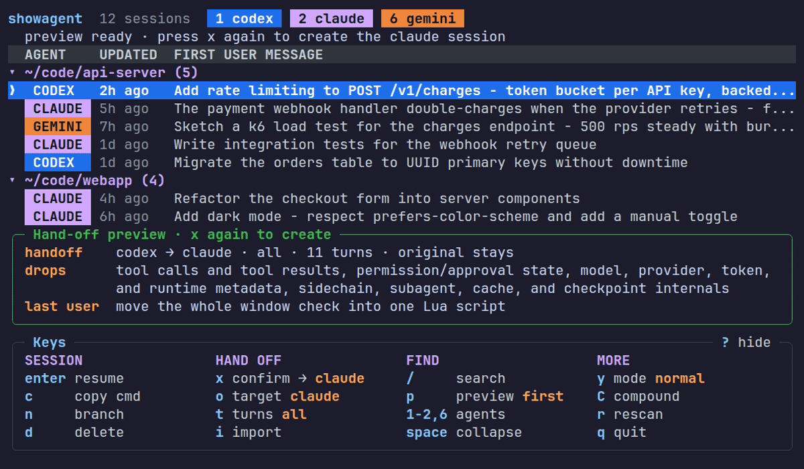

<!-- mcp-name: io.github.aytzey/showagent -->
# showagent

**Switch coding agents mid-task and keep the conversation.**

Hit your Claude Code limit halfway through a fix? Find the conversation in your
terminal and open it in Codex as a native session in the same workspace. Or
branch from an earlier user message and take the conversation in a new
direction.

The picker reads [eight agents' local histories](#supported-agents), including
Gemini CLI, OpenCode, Antigravity, and Pi.

[](https://github.com/aytzey/showagent/actions/workflows/ci.yml)
[](https://github.com/aytzey/showagent/releases/latest)
[](LICENSE)

## Install

**Linux and macOS**

```sh
curl -fsSL https://raw.githubusercontent.com/aytzey/showagent/main/scripts/install.sh | sh
```

With Homebrew, run `brew install aytzey/tap/showagent`. Check with
`showagent --version`, then run `showagent` to open the picker.

The shell installer verifies the release checksum and normally installs to
`~/.local/bin`. If your shell can't find `showagent`, add that directory to
`PATH` or run `~/.local/bin/showagent` directly.

**Windows (experimental)** · Extract the `windows_amd64.zip` asset from the
[latest release](https://github.com/aytzey/showagent/releases/latest). In the
extracted folder, run `.\showagent.exe --version` to check the install, then
`.\showagent.exe` to open the picker. Use `.\showagent.exe` in place of
`showagent` when running the examples from that folder.

<details>
<summary>Go install, manual downloads, and release details</summary>

You can also install from Go 1.26.11+ with
`go install github.com/aytzey/showagent/cmd/showagent@latest` or download a
platform archive from the [latest release](https://github.com/aytzey/showagent/releases/latest).
For updating and checking which features your install includes, see
[distribution details](docs/distribution.md).

Release assets include `SHA256SUMS`. To check build provenance for a current
release asset, run `gh attestation verify FILE --repo aytzey/showagent`.

</details>

## Quick start



[Watch the 23-second hand-off demo](docs/demo.gif). It uses sample sessions and
the real showagent picker. The final agent CLI output is simulated.

These hand-off examples use showagent v0.16.0 or newer. Have a saved session,
its workspace, and a signed-in target CLI on `PATH`. Run `showagent` to see
local sessions grouped by workspace.

1. Press `/` to search by workspace or words in the first or latest prompt.
   Press `enter` to finish searching, then select the session.
2. Press `o` to choose the target agent, then `x` to choose where it picks up.
   Select **Continue from the end** and press `enter` to preview the hand-off.
3. Press `x` to create the new session, then `enter` to open it in the target CLI.

### Hand off from the command line

Run `showagent list` and copy the ID of the Codex session you want. Replace
`SESSION_ID` below to preview the workspace, transferable turn count, and last
user request in the range you're copying.

```sh
showagent convert SESSION_ID --to claude --dry-run
```

When you're ready to create the session and open Claude Code, run this command.

```sh
showagent convert SESSION_ID --to claude --open
```

For the reverse direction, choose a Claude Code session and use `--to codex`.
The [hand-off guide](docs/handoff-guide.md) walks through verifying and resuming
the new session.

### What moves

The copy carries user and assistant message text, including code blocks and
indentation. Tool calls and results, approvals, attachments, and private runtime
state stay with the source. The copy gets its own session ID and opens in the
same workspace with the current project files. Read the
[full transfer details](docs/handoff-guide.md#what-moves-with-the-conversation).

## Branch from any message

Suppose the fourth request sent a rate-limiting fix toward a sliding window,
and you want to try a token bucket instead. Select the session, press `n`, and
search with `/` for `sliding`. Press `enter` to finish searching, then `tab`
to leave that request out. The chooser shows how many turns the branch keeps.
Press `enter` to create the branch in the same agent. The original conversation
stays available.

```sh
showagent messages SESSION_ID --all
showagent branch SESSION_ID --before-user 4 --dry-run
```

Replace `--dry-run` with `--open` to create and open the branch. Use
`--through-user 4` to include the fourth user message and end there.
Both cutoffs work with `convert` too. [Watch the 20-second branch demo](docs/branch.gif),
recorded with sample sessions and simulated agent CLI output.

### Trim the current conversation

Trimming requires showagent v0.17.0 or later. [Build from source](#building)
if your picker help has no `D` key.

Close the conversation in its agent, then select it in showagent and press
uppercase `D`. Pick a user message, press `enter` to preview, then press
uppercase `D` on that screen to confirm. The conversation keeps its session ID.
Codex trims whole turns from its active conversation and keeps the previous
rollout on disk. See the
[cutoff options and supported formats](docs/cli-reference.md#trimming-a-conversation).

## Supported agents

| Agent | CLI | Session store | Override | Hand-off target |
|---|---|---|---|---|
| Codex | `codex` | `~/.codex/sessions`, `~/.codex/multica-sessions` | `CODEX_HOME` | Yes |
| Claude Code | `claude` | `~/.claude/projects` | `CLAUDE_HOME` | Yes |
| Gemini CLI | `gemini` | `~/.gemini/tmp/<project>/chats` | `GEMINI_CLI_HOME` | Yes |
| Antigravity | `agy` | `~/.gemini/antigravity-cli`, `~/.gemini/antigravity-ide` | `ANTIGRAVITY_HOME` | Source only |
| OpenCode | `opencode` | `opencode.db` via its CLI | `OPENCODE_DATA_HOME` | Yes |
| MiMoCode | `mimo` | `mimocode.db` via its CLI | `MIMOCODE_HOME` | Yes |
| Pi | `pi` | `~/.pi/agent/sessions` | `PI_CODING_AGENT_DIR`, `PI_CODING_AGENT_SESSION_DIR` | Yes |
| jcode | `jcode` | `~/.jcode/sessions` | `JCODE_HOME` | Yes |

All eight can be hand-off sources. The picker offers installed targets.
Antigravity CLI sessions can reopen in `agy`. Antigravity IDE sessions support
hand-off to another agent. See the [compatibility record](docs/compatibility.md)
for tested CLI versions, platforms, and transfer directions.

<details>
<summary>Provider-specific discovery and conversion</summary>

- OpenCode, MiMoCode, and jcode appear when their CLI is installed. OpenCode and
  MiMoCode handle imports through their own CLI. See
  [discovery and caching](docs/discovery.md) for OpenCode version differences.
- Pi follows the active conversation branch. Launch showagent from a project
  to pick up that project's custom Pi session directory. Use
  `PI_CODING_AGENT_SESSION_DIR` to select a directory globally.
- CLI conversions to file-backed targets can prepare a session before you
  install the target CLI. Add `--open` once the target is available.

</details>

## Commands

| Do this | Run |
|---|---|
| List or script against local sessions | `showagent list` or `showagent list --json` |
| Open a known session directly | `showagent resume SESSION_ID` |
| Print its resume command and storage location | `showagent info SESSION_ID` |
| Export recent messages as redacted Markdown | `showagent transcript SESSION_ID --markdown` |
| Preview importing a ChatGPT or Claude share | `showagent import --url SHARE_URL --to codex --cwd . --dry-run` |
| Update a standalone install | `showagent update` |
| See all commands and flags | `showagent --help` |

You can use `latest` in place of a session ID to select the most recently
updated session across all agents and workspaces. For scripts that preview and
then write, use an explicit ID so both commands refer to the same source. See
[web conversation import](docs/web-import.md) for file, clipboard, and
existing-session import options.

### Keybindings

| Key | Action |
|---|---|
| `enter` / `c` | Open the selected session or copy its resume command |
| `/` | Search sessions by agent, ID, workspace, and first or latest prompt |
| `o` / `x` | Choose a target agent or start a hand-off |
| `n` | Branch within the same agent |
| `i` | Import a public share link or pasted transcript |
| `r` | Refresh the session list |
| `?` | Show or hide the key hints |
| `q` / `ctrl+c` | Quit |

See the [full picker keybindings](docs/cli-reference.md#keybindings) for scope,
filters, previews, and the message chooser.

### Compound engineering

Press `C` to resume with a prompt that records durable project learnings as
Markdown. `showagent setup` installs the
[compound-engineering plugin](https://github.com/EveryInc/compound-engineering-plugin)
for supported local agents. See the
[setup and storage details](docs/cli-reference.md#compound-engineering).

## Scripting

Use `showagent list --json` to consume stable session fields and
`showagent transcript SESSION_ID --json` for bounded, redacted conversation
text. The [CLI reference](docs/cli-reference.md#scripting) has an example
response, exit codes, and behavior outside a terminal.

## Use it from inside your agent (MCP)

`showagent mcp` serves local session history over stdio. An MCP client can list
sessions, read recent turns, preview a hand-off, and get the resume command.
Start with `--read-only` for these operations. The default mode also exposes
tools to write a branch or hand-off.

```sh
# Claude Code
claude mcp add showagent -- showagent mcp --read-only
```

```toml
# Codex (~/.codex/config.toml)
[mcp_servers.showagent]
command = "showagent"
args = ["mcp", "--read-only"]
```

For tool parameters, desktop bundles, and agent instructions, see the
[MCP tool reference](skills/showagent-session-handoff/references/tool-reference.md),
[distribution details](docs/distribution.md), and
[handoff skill](skills/showagent-session-handoff).

## How it compares

See how other local session tools handle the same job in the
[November 2026 comparison](docs/comparison.md).

## FAQ

**Where does session data go?** showagent processes conversations on your machine.
Picker previews, transcript exports, and MCP reads redact common secrets by
default. A hand-off copies the original message text, and an MCP client can
send returned context to its model provider. Release checks and explicit
public-share imports make network requests. Set `SHOWAGENT_NO_UPDATE_CHECK=1`
to disable the startup release check.

**A session is missing.** Press `r` to rescan. When no sessions are found,
`showagent list` prints the directories it checked and their environment
overrides. See [discovery and caching](docs/discovery.md).

**How do I update?** Run `showagent update` for standalone installs or
`brew upgrade aytzey/tap/showagent` for Homebrew. Check `showagent --version` and
`showagent --help` against the [distribution notes](docs/distribution.md).

## Contributing

### Building

Use Go 1.26.11 or newer.

```sh
git clone https://github.com/aytzey/showagent.git
cd showagent
go test ./...
go build -o showagent ./cmd/showagent
```

Read the [contribution guide](CONTRIBUTING.md) and
[demo recording instructions](demo/README.md).
Report security issues privately using the [security policy](SECURITY.md).

### Adding a provider

Add the provider to the registry and give it an environment override so tests
can use isolated stores. The current adapters cover file-backed stores,
CLI-backed stores, and hand-off sources.
[Provider interface](internal/session/provider.go) ·
[Gemini CLI example](internal/session/gemini.go) ·
[OpenCode example](internal/session/opencode.go) ·
[Antigravity example](internal/session/antigravity.go)

Request support for another agent with an
[agent request](https://github.com/aytzey/showagent/issues/new?template=provider_request.yml).

If showagent saved you from re-explaining a task, a
[GitHub star](https://github.com/aytzey/showagent/stargazers) helps others find it.

## License

[MIT](LICENSE). Built with [Bubble Tea](https://github.com/charmbracelet/bubbletea),
[Bubbles](https://github.com/charmbracelet/bubbles), and
[Lip Gloss](https://github.com/charmbracelet/lipgloss).
